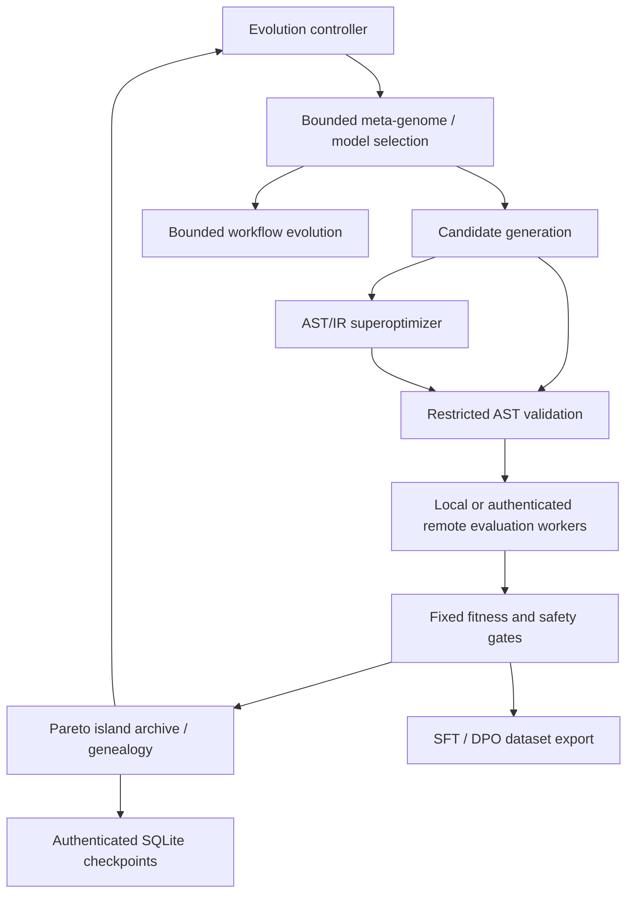

# OMEGA-X Evolution Ω

> **Current acceptance policy:** [Mandatory execution directive v3.0](docs/omega/EXECUTION_DIRECTIVE_V3.md) supersedes conflicting historical criteria. External audits, third-party certification and physical infrastructure reruns are not required. Accepted deterministic engineering simulations close modeled properties. Native/production claims and functional or mathematical obligations remain distinct.


**Autonomous Evolutionary Intelligence & Scientific Discovery Engine**


OMEGA-X Evolution is an independent research and engineering project maintained in [mojealterego/Omega-X-Evolution-](https://github.com/mojealterego/Omega-X-Evolution-). Its objective is to create a controlled, reproducible evolutionary intelligence engine that discovers and improves algorithms, optimizes search strategies, and progressively evolves agent workflows under fixed verification and resource constraints.

The project builds upon the open-source ShinkaEvolve framework and incorporates research ideas from AlphaEvolve and the Darwin Gödel Machine. These are foundations and research references, not claims of equivalent implementations, reproduced scientific results, or superiority.

## Architecture



The diagram describes the implemented optional OMEGA-X research path. The general upstream execution path is separate and does not inherit its restricted interpreter guarantees.

## Current implementation — v36.4

| Component | Capability |
|---|---|
| Runtime hardening | Process lifecycle, SLURM shell safety and integrity regression checks |
| Pareto–Gödel–Elites | Multi-objective selection, island archives, genealogy and migration |
| MetaGenome | Bounded adaptation of selection parameters and model routing |
| Candidate validation | Restricted arithmetic expression interpreter and exact patch contract |
| Evaluation | Fixed benchmark, staged validation, holdout excluded from worker inputs |
| Persistence | Authenticated SQLite generation snapshots and deterministic offline resume |
| Parallelism | Local process pool and authenticated network worker protocol, durable leases, deterministic commits |
| Meta-agent | Bounded mutation of operator workflows with independent seed promotion |
| AST/IR | Binary64-preserving source rewrites and common-subexpression elimination |
| Formal verification | Nine Z3-checked binary64 rewrite families and independent IR verification |
| Knowledge distillation | Offline categorical teacher/student operator model plus SFT/DPO export |
| Multilevel coevolution | Role-specific workflows, migrating team demes, fixed validation promotion |
| Recursive improvement | Fresh validation gates, bounded policy iteration and outer checkpoint |
| Benchmarking | Equal proposal-budget paired comparisons |
| Discovery | Bounded symbolic regression and reproducible evidence |
| Polyglot evolution | Validated u16 IR and six native/interpreted language backends |
| Neuro-symbolic | Certified symbolic expression plus trained residual MLP |
| Neural architecture search | Bounded evolution of hidden layers, activation, learning rate and optimizer; real CPU training |
| Heterogeneous inference | CPU and optional Torch CUDA/MPS/Ascend NPU adapters; memory admission and reference checking |
| Graph memory | Tenant-scoped authenticated nodes and edges, bounded cited retrieval |
| Experiment planner | Budget-driven symbolic/neural/hybrid comparison with final test isolation |
| Multi-domain discovery | Unit-constrained sparse regression over up to eight inputs; custom data |
| Research runtime | Checkpointed campaigns with fixed typed dispatch, budgets, graph recording and replay |
| Stage 3 latency regression | Opt-in paired p50/p95/p99 gate against accepted parent and cell elite/global champion; authenticated history |
| Asynchronous island cluster | Per-island CAS snapshots, bounded asynchronous ring, Ray adapter and local process transport |
| Adaptive phenotype geometry | Entropy-driven SPD metric, graph shortest paths, adaptive quadtree and guided mutation |
| Annealed tensor policy | Actual TT-SVD contextual reward approximation and Gibbs selection |
| Associative trajectory memory | Stable int8 keys, Hopfield-style read, verified cross-island records |
| Formal safety synthesis | Mandatory AST-generated whole-domain binary64 obligations, independent rational checker, CTL and modal K, durable derived-rule registry |
| Hybrid QUBO selection | Cardinality-constrained MAP-Elites representative selection; classical and optional QPU |
| Memory architecture synthesis | Typed retrieval DAG search and validation promotion |
| Swarm federation | Ed25519 peer packets, durable inboxes, independent proof/evaluation, P2P transport |
| Code epigenetics | Runtime hysteretic activation of optional proposal blocks under host pressure |
| Proof kernel | Modular u16 constructive certificates with separate checker and optional Lean adapter |
| Neuro-symbolic swarm | Signed quorum-certified search partitions, durable peer locks, trainable proposal router and deterministic result replay |
| Axiomatic discovery | Grammar-generated modular conjectures, counterexamples, constructive proofs and exhaustive finite algebra classification |
| Weight plasticity | Frozen contextual router with bounded LoRA, retention validation, authenticated adapter selection and rollback |
| Infrastructure orchestration | Local Linux child lifecycle, durable CPU reservations, resource limits, bounded parallelism and stop/recovery |
| Backlog extensions | Durable team populations, whole-domain u16 SMT, isolated Torch training, latent-semantic graph retrieval and optional local LLM quote selection, Qualcomm HTP adapter |

**Status:** development snapshot, not a production distributed system. The network evaluator has been tested on loopback with actual worker processes and TLS; no external cluster, HA coordinator or throughput gain is established. Independent recomputation is mandatory. Arbitrary-code execution, unrestricted agent self-rewriting, formal verification of arbitrary programs and large-model training remain out of scope. Small MLPs now train end-to-end on CPU in explicit research modes.

## Roadmap

| Stage | Objective | Status |
|---|---|---|
| v1–v3 | Hardening, bounded coevolution, durable recovery | Implemented within documented scope |
| v4.1 | Distributed evaluation | Implemented within bounded protocol; local network/process/TLS verification |
| v5 | Meta-agent evolution | Bounded operator workflow evolution implemented and verified |
| v6 | AST/IR superoptimization | Bounded binary64 rewrite + DAG IR implemented and verified |
| v7 | Formal verification | Bounded rewrite rule proofs and IR checker implemented |
| v8 | Knowledge distillation | Categorical operator student fitted and evaluated offline |
| v9 | Multilevel coevolution | Three-level bounded team evolution implemented and evaluated |
| v10 | Recursive self-improvement with fixed promotion gates | Bounded policy iteration with authenticated outer checkpoints |
| v11 | Comparative benchmarks | Paired offline strategy comparisons; external reproduction open |
| v12 | Scientific Discovery Engine | Two-variable symbolic regression from observations |
| v13 | Polyglot program evolution | Pure u16 IR; Python, C, C++, JavaScript, Go, Java; arbitrary programs open |
| v14 | Neuro-Symbolic Evolution Engine | Verified symbolic regression + learned residual; bounded two-variable domain |
| v15 | Algorithm and neural architecture evolution | Real MLP training, architecture and optimizer search; large models open |
| v16 | Heterogeneous CPU/GPU/NPU orchestration | Bounded MLP inference router; CPU verified, accelerator hardware open |
| v17 | Durable GraphRAG evolutionary memory | Authenticated SQLite graph and lexical/provenance retrieval |
| v18 | Automatic experiment construction | Typed budgeted comparative plans, validation selection and graph recording |
| v19 | Multi-domain Scientific Discovery Engine | Unit-constrained sparse equation discovery; four synthetic physical domains and custom data |
| v20 | Integrated autonomous research runtime | Bounded seven-domain campaigns, durable recovery, graph evidence, replay and device policy |
| v21 | Performance regression testing | Implemented Stage 3b; measured latency, correctness tradeoff, durable evidence |
| v22 | Asynchronous cluster archipelago | Implemented bounded 512-island API, durable per-island state and Ray transport; real local process tests, Ray deployment open |
| v23 | Topological State-Space Evolution | Adaptive quadtree, finite Riemannian graph metric and cluster integration; bounded local verification |
| v24 | Quantum-inspired policy search | Classical rank-bounded tensor train; paired cost/quality benchmark |
| v25 | Holographic memory compression | Bounded associative trajectory retrieval and ring transfer |
| v26 | Formal verification synthesis | Mandatory pre-evaluation gate, independent interval check, general CTL/K, learned safety theorems; closure patch v35.1 |
| v27 | Quantum-assisted annealing | Bounded QUBO and classical reference; optional QPU unverified |
| v28 | Memory architecture synthesis | Typed retrieval composition, dataset-split promotion |
| v29 | Swarm federation | Signed peer exchange, independent qualification, local process/TLS tests |
| v30 | Code epigenetics | Bounded reversible runtime switches, mandatory gates immutable |
| v31 | Neurosymbolic formal verification | Constructive u16 ring proofs, native Lean tested across all six IR operators; full BVDecide and Isabelle open |
| v32 | Neuro-symbolic swarm | Signed quorum plans and independently replayed peer execution; one-shot fault model, local process tests |
| v33 | Zero-shot axiomatic discovery | Bounded proof and counterexample search; finite algebra enumeration |
| v34 | On-the-fly weight plasticity | Actual low-rank CPU updates on verified trajectories; no LLM weights |
| v35 | Autonomous infrastructure orchestration | Local process lifecycle and budget accounting; external provisioning open |
| v36 | Green Computing | Paired measured process CPU timing, estimated energy/carbon with explicit provenance and bounds; physical energy attribution open |

See [extended maintainer roadmap v36](docs/omega/MAINTAINER_ROADMAP.md).

No stage is promoted solely on generated logs or self-reported improvements.

## Getting started

Requires Python 3.10 or newer. Install from this repository, not the upstream PyPI package, to obtain the OMEGA-X extensions.

```bash
git clone https://github.com/mojealterego/Omega-X-Evolution-.git
cd Omega-X-Evolution-
python -m venv .venv
source .venv/bin/activate
python -m pip install -e .
omega-x-evolution --seed 5 --generations 5 --evaluation-processes 2
# Or: python -m omega_x_evolution --seed 5 --generations 5 --evaluation-processes 2
```

This command uses the bounded offline experiment; it does not require paid inference. The canonical distribution is `omega-x-evolution` (development version `0.36.4.dev1`), with implementation in `omega_x_evolution`. The offline engine uses the standard library. The imported Shinka runtime and compatibility entry points remain bundled, so use a separate virtual environment from upstream `shinka-evolve`. See [migration guide](docs/omega/IDENTITY_MIGRATION.md).

## Advanced modes

```bash
python -m omega_x_evolution.distributed --help
python -m omega_x_evolution.meta --rounds 3 --population 4 --generations 3
python -m omega_x_evolution.superopt '(-(-(x*1))/1)+(x+y)*(x+y)'
```

See [v4.1–v6 deployment and acceptance scope](docs/omega/EVOLUTION_V41_V6.md) before enabling network endpoints. The canonical offline engine requires only the standard library; legacy upstream components retain their dependencies.

## v7–v9 research commands

```bash
omega-x-formal --rules
omega-x-knowledge --records-per-seed 12
omega-x-multilevel --rounds 3 --demes 3 --population 4 --generations 2
```

Certified optimization requires a system Z3 shared library. See the [scope and instructions](docs/omega/EVOLUTION_V7_V9.md).

## v10–v12 research commands

```bash
omega-x-recursive --rounds 4 --population 5 --generations 2
omega-x-benchmarks --budget 256
omega-x-discovery --task squares --seed 2026 --budget 128
```

See [bounded implementation and remaining gaps](docs/omega/EVOLUTION_V10_V12.md).

## v13–v15 research commands

```bash
omega-x-polyglot --seed 42 --budget 1024 --verify
omega-x-hybrid --seed 42 --epochs 400
omega-x-nas --seed 42 --task xor --rounds 3 --population 4 --epochs 180
```

Neural modes require NumPy, hybrid also requires system Z3; compiler verification uses installed local toolchains. See [v13–v15 scope and evidence](docs/omega/EVOLUTION_V13_V15.md).

## v16–v18 research commands

```bash
omega-x-compute --torch --npu --demo
omega-x-experiments --task smooth --epochs 400 --budget 128
omega-x-experiments --task smooth --plan-only
```

CPU inference is verified locally; optional accelerator adapters require installed compatible Torch runtimes and real hardware. Graph memory and experiment planning are documented in [v16–v18](docs/omega/EVOLUTION_V16_V18.md).

## v19–v20 research commands

```bash
omega-x-science --domain kinematics --seed 42
omega-x-research --domains kinematics mechanics kinetics dynamics bits numeric scheduler --budget 1024 --epochs 100
omega-x-training --device cpu --epochs 25
omega-x-bitproof --left '["sub",["add",["x"],["y"]],["y"]]' --right '["x"]'
omega-x-compute --qnn --demo
```

See [v19–v20 implementation and evidence](docs/omega/EVOLUTION_V19_V20.md) and the [remaining acceptance gates](docs/omega/CLOSURE_REGISTER.md). All original 20 stages now have bounded local implementations; hardware, external validation and unrestricted-domain objectives are not declared closed. Stages v21 and v22 implement the first two new maintainer requirements; v23 adds adaptive phenotype geometry; v24–v26 add tensor policies, associative trajectories and generated numeric safety obligations; see [the extended maintainer roadmap](docs/omega/MAINTAINER_ROADMAP.md) for all remaining source requirements.

## v21 performance regression gate

```bash
omega-x-evolution --seed 5 --generations 3 --islands 2 --workers 2 --performance-regression
```

The measured gate is automatically applied to every Stage 3-qualified candidate in this explicit mode, before archive admission, including local process pools and remote evaluation. Default deterministic mode retains the historical operation proxy. Measured decisions are not repeatable bit-for-bit across new runs. See [policy, durable history and compatibility](docs/omega/EVOLUTION_V21.md).

## v22 asynchronous MAP-Elites cluster

```bash
# Generate a private key once; keep the database and key outside the repository.
python -m omega_x_evolution.cluster --backend process --islands 16 --rounds 4 --batch 2 --budget 128 --parallelism 4 --db cluster.db --key-file cluster.key
# On an existing private, operator-managed Ray cluster:
# python -m pip install ".[cluster]"
python -m omega_x_evolution.cluster --backend ray --ray-address auto --islands 128 --rounds 2 --batch 2 --budget 512 --parallelism 128 --db ray.db --key-file cluster.key
```

See [v22 deployment, recovery and verified limits](docs/omega/EVOLUTION_V22.md). No Ray runtime was available in the validation environment; explicit Ray mode fails rather than silently simulating.

## v23 adaptive topology

```bash
python -m omega_x_evolution.cluster --backend process --islands 16 --rounds 3 --batch 4 --budget 192 --parallelism 4 --migration-interval 1 --topology --db topo.db --key-file cluster.key
```

See [geometry, evidence and limits](docs/omega/EVOLUTION_V23.md).

## v24–v26 tensor policy, memory and safety proof

```bash
python -m omega_x_evolution.cluster --backend process --islands 8 --rounds 4 --batch 4 --budget 128 --parallelism 4 --migration-interval 1 --topology --annealed --holographic --formal-safety --db v26.db --key-file cluster.key
python -m omega_x_evolution.safety_synthesis -- '-(x+y+(x-y)*(x-y)/(.01+x*y)+2)'
```

See [v24–v26 scope and evidence](docs/omega/EVOLUTION_V24_V26.md). All modes opt-in, proof precedes empirical tests; no live LLM/quantum speedup claim.

## v27–v29 QUBO, memory architecture and federation

```bash
python -m omega_x_evolution.quantum --seed 42 --steps 512
python -m omega_x_evolution.architecture --help
python -m omega_x_evolution.federation --help
```

See [scope, deployment and evidence](docs/omega/EVOLUTION_V27_V29.md). Physical QPU and multi-host peer acceptance are open; explicit external authorization required.

## v30–v32 epigenetics, proof kernel and swarm

```sh
python -m omega_x_evolution.epigenetics
python -m omega_x_evolution.proof_kernel
python -m omega_x_evolution.swarm --help
```

See [scope and evidence](docs/omega/EVOLUTION_V30_V32.md). Swarm execution operates in an independent research namespace and uses the fixed numerical safety and evaluation gates; it does not bypass a live campaign.

## v33–v35 discovery, plasticity and infrastructure

```sh
python -m omega_x_evolution.axioms --seed 42 --budget 256
python -m omega_x_evolution.plasticity --steps 400 --authorize-training
python -m omega_x_evolution.infrastructure --help
```

See [scope and evidence](docs/omega/EVOLUTION_V33_V35.md). Training and process execution are explicitly authorized and bounded; no automatic cloud allocation.

## Mandatory formal safety closure (requirements 1–4)

The v35.1 closure patch does not add a roadmap stage. All scheduler candidate evaluations now require whole-domain numerical safety proof from the validated AST. The former optional `--formal-safety` switch controls detailed cluster evidence retention; it no longer enables/disables the gate. `ImmutableAuditKernel` binds the certificate and matched proved rules to admission. See [formal safety acceptance and residual scope](docs/omega/FORMAL_SAFETY_CLOSURE.md).

```sh
python -m omega_x_evolution.safety_synthesis -- '1/(.25+x)'
python -m omega_x_evolution.modal --formula '["implies",["box",["atom","p"]],["atom","p"]]'
```

The second command intentionally produces a countermodel in logic K and a nonzero exit code. Numerical smoke tests are replaced by proof; functional properties, benchmark, latency policy and audit remain mandatory. The original unrestricted Shinka path does not inherit these guarantees.

## Maintainer corrective release v35.2 (requirements 5–12)

See [bounded implementation and residual acceptance](docs/omega/REMAINING_REQUIREMENTS_CLOSURE.md) for constrained QUBO, memory synthesis, discovery/gossip, cluster switches, extensional proof, round-based quorum coordination, polynomial/Laurent discovery, online transformer adapters and Kubernetes workload control. Physical infrastructure and general research claims remain separately gated.

## Corrective release v35.3

See [residual gates and evidence](docs/omega/RESIDUAL_ACCEPTANCE.md): certified round changes and autonomous pacemaker, resumable architecture synthesis, Lean/Isabelle adapters, local model admission and microbatch training, and reduced upstream import coupling. Remaining physical and toolchain gates are explicitly open.

## Verification

```bash
python -m pip install pytest
python -m pytest -q tests/test_omega*.py
python scripts/verify_hardening.py
```

The imported v4 verification record reports 42 targeted OMEGA tests and 38 hardening tests passed. Full upstream collection was blocked by missing dependencies. No live distributed cluster, external scientific benchmark reproduction, large-model training or production attestation is claimed. These are historical results. See [current verification](docs/omega/verification-residual.txt) for the new regression results and outstanding upstream dependency limitations.

## Documentation & evidence

- [v33–v35 discovery, plasticity and infrastructure](docs/omega/EVOLUTION_V33_V35.md)
- [v30–v32 epigenetics, proof kernel and swarm](docs/omega/EVOLUTION_V30_V32.md)
- [v27–v29 QUBO, architectures and federation](docs/omega/EVOLUTION_V27_V29.md)
- [v24–v26 tensor policies, memory and safety](docs/omega/EVOLUTION_V24_V26.md)
- [v23 adaptive topological archive](docs/omega/EVOLUTION_V23.md)
- [Extended maintainer roadmap](docs/omega/MAINTAINER_ROADMAP.md)
- [v22 asynchronous MAP-Elites](docs/omega/EVOLUTION_V22.md)
- [v21 Stage 3 performance regression gate](docs/omega/EVOLUTION_V21.md)
- [v19–v20 implementation and evidence](docs/omega/EVOLUTION_V19_V20.md)
- [Unresolved and closed acceptance gates](docs/omega/CLOSURE_REGISTER.md)

- [v16–v18 implementation and evidence](docs/omega/EVOLUTION_V16_V18.md)

- [v13–v15 implementation and evidence](docs/omega/EVOLUTION_V13_V15.md)
- [v10–v12 implementation and evidence](docs/omega/EVOLUTION_V10_V12.md)
- [v7–v9 implementation and evidence](docs/omega/EVOLUTION_V7_V9.md)
- [v4.1–v6 implementation, benchmarks and operating instructions](docs/omega/EVOLUTION_V41_V6.md)
- [Namespace and packaging migration](docs/omega/IDENTITY_MIGRATION.md)
- [OMEGA-X coevolution architecture](docs/OMEGA_COEVOLUTION.md)
- [Runtime hardening](docs/OMEGA_HARDENING.md)
- [Research traceability v4](docs/omega/RESEARCH_TRACEABILITY_v4.md)
- [Verification record v4](docs/omega/verification-v4.txt)
- [Original import record](OMEGA_IMPORT.md)
- [Imported source manifest v4](docs/omega/IMPORT_MANIFEST_v4.json) — historical snapshot, not a manifest of subsequent changes.
- [Preserved ShinkaEvolve documentation](README.upstream.md)

## Engineering & security policy

Development takes place on `main`. Upstream GitHub Actions definitions remain inactive in `docs/upstream-workflows/`. Promotion requires reproducible evidence and explicit verification. Evolution must not weaken evaluator integrity, fixed safety gates, authorization, or operator resource limits. Local multiprocessing is not a security sandbox.

## Origins and license

OMEGA-X Evolution is a separately maintained derivative project, not an official Sakana AI or Google DeepMind release.

- **ShinkaEvolve** — Sakana AI; [source repository](https://github.com/SakanaAI/ShinkaEvolve), [paper](https://arxiv.org/abs/2509.19349). Original authorship, citations and documentation are retained in [README.upstream.md](README.upstream.md).
- **AlphaEvolve** — Google DeepMind; [research overview](https://deepmind.google/discover/blog/alphaevolve-a-gemini-powered-coding-agent-for-designing-advanced-algorithms/).
- **Darwin Gödel Machine** — Sakana AI and collaborators; [research overview](https://sakana.ai/dgm/).

See [LICENSE](LICENSE) for the Apache-2.0 license. Existing copyright and attribution notices are preserved. Research references are not automatically redistributed as project-owned code.

---

**OMEGA-X Evolution Ω · Evolution with evidence.**

## Corrective release v35.4

See [residual recovery and evidence](docs/omega/RESIDUAL_RECOVERY_V354.md). No new roadmap stage.

## Corrective release v35.5

See [terminal-round recovery, durable budget extension and offline dependency verification](docs/omega/RESIDUAL_RECOVERY_V355.md). No new roadmap stage.

## v36 — Green Computing and certified round recovery

See [v36 implementation and acceptance](docs/omega/EVOLUTION_V36.md). The paired green profile uses actual process CPU time and operator-supplied power/intensity scenarios; it does not attribute measured electricity to the workload. BFT replicas can synchronize directly to a higher round with a genuine quorum timeout certificate while preserving locks. [Reproducible verification](docs/omega/verification-v36.txt) records the remaining GATE-09 blockers.

```sh
omega-x-green --task squares --seed 42 --budget 128 --repeats 3 --watts 5 15 35 --power-source 'illustrative CPU power scenario' --intensity 400 --intensity-source 'illustrative grid scenario'
python scripts/verify_bft_lemmas.py
```

**v36.1 — deterministic engineering acceptance:** [modeled contracts, evidence and residual gates](docs/omega/SIMULATION_ACCEPTANCE_V361.md). OMEGA v2.3 §5: successful deterministic simulation closes the corresponding engineering property without a mandatory physical rerun. Native and production claims are separate. Earlier infrastructure-only blocker statements are superseded; no mathematical, compatibility or dependency failure is concealed.

See [upstream changelog](CHANGELOG.md) and [contributing](CONTRIBUTING.md) for inherited maintenance conventions.

**v36.2:** [Extended round recovery, streaming synthesis and upstream recovery](docs/omega/RESIDUAL_RECOVERY_V362.md). Historical round-31 deadlock reproduced and fixed in signed deterministic execution. Streaming search crosses 8192 evaluations with a durable cursor; retained grammar limits are explicit. Upstream dependency recovery and remaining acceptance conditions are recorded separately.

**v36.3:** [Native Lean bootstrap and proof acceptance](docs/omega/NATIVE_LEAN_V363.md). Actual offline Lean 4.36.0-pre compiler built from upstream sources, 50-module portable proof runtime; extensional equations over BitVec 16 × BitVec 16 verified natively for tested additive cases, false equality rejected, shared proof adapter and replay. Full Std/CaDiCaL and Isabelle remain open. GATE-09 remains partially blocked.

**v36.4:** [Native BitVec expansion and source inventory](docs/omega/NATIVE_BITVEC_V364.md). Kernel-checked lemma route spans all six u16 IR operators; 376 core tests passed on independent packaged runtime. 173-module upstream BitVec.Lemmas closure built; portable runtime and build cache preserved. Full BVDecide, Isabelle and other residual obligations remain open.


**v36.4 native checkpoint increment 488→500:** [build and replay evidence](docs/omega/NATIVE_STD_BVDECIDE_500.md). 92 additional pinned sources, 12 new compiled modules, 500 total; verified reconstruction and six native proof/checker replays. Full elaborator remains open; no physical/hardware or external audit prerequisite.
