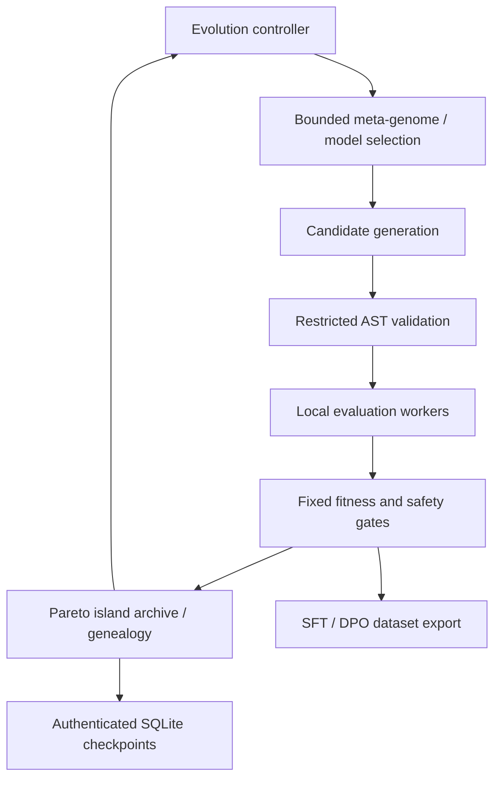

# OMEGA-X Evolution Ω


**Autonomous Evolutionary Intelligence & Scientific Discovery Engine**


OMEGA-X Evolution is an independent research and engineering project maintained in [mojealterego/Omega-X-Evolution-](https://github.com/mojealterego/Omega-X-Evolution-). Its objective is to create a controlled, reproducible evolutionary intelligence engine that discovers and improves algorithms, optimizes search strategies, and progressively evolves agent workflows under fixed verification and resource constraints.

The project builds upon the open-source ShinkaEvolve framework and incorporates research ideas from AlphaEvolve and the Darwin Gödel Machine. These are foundations and research references, not claims of equivalent implementations, reproduced scientific results, or superiority.

## Architecture



The diagram describes the implemented optional OMEGA-X research path. The general upstream execution path is separate and does not inherit its restricted interpreter guarantees.

## Current implementation — v4

| Component | Capability |
|---|---|
| Runtime hardening | Process lifecycle, SLURM shell safety and integrity regression checks |
| Pareto–Gödel–Elites | Multi-objective selection, island archives, genealogy and migration |
| MetaGenome | Bounded adaptation of selection parameters and model routing |
| Candidate validation | Restricted arithmetic expression interpreter and exact patch contract |
| Evaluation | Fixed benchmark, staged validation, holdout excluded from worker inputs |
| Persistence | Authenticated SQLite generation snapshots and deterministic offline resume |
| Parallelism | Trusted local process pool, deterministic result ordering |
| Knowledge export | SFT and DPO records, without automatic training |

**Status:** development snapshot, not a production distributed system. Remote-worker transport, cross-host leases and fencing, arbitrary-code isolation, formal proofs, and end-to-end model training are not implemented or demonstrated by this release.

## Roadmap

| Stage | Objective | Status |
|---|---|---|
| v1–v3 | Hardening, bounded coevolution, durable recovery | Implemented within documented scope |
| v4 | Distributed evaluation | Local multiprocessing implemented; multi-host work pending |
| v5 | Meta-agent evolution | Open |
| v6 | AST/IR superoptimization | Open |
| v7 | Formal verification | Open |
| v8 | Knowledge distillation | Open |
| v9 | Multilevel coevolution | Open |
| v10 | Recursive self-improvement with fixed promotion gates | Open |
| v11 | Comparative benchmarks | Open |
| v12 | Scientific Discovery Engine | Open |

No stage is promoted solely on generated logs or self-reported improvements.

## Getting started

Requires Python 3.10 or newer. Install from this repository, not the upstream PyPI package, to obtain the OMEGA-X extensions.

```bash
git clone https://github.com/mojealterego/Omega-X-Evolution-.git
cd Omega-X-Evolution-
python -m venv .venv
source .venv/bin/activate
python -m pip install -e .
omega-x-evolution --seed 5 --generations 5 --evaluation-processes 2
# Or: python -m omega_x_evolution --seed 5 --generations 5 --evaluation-processes 2
```

This command uses the bounded offline experiment; it does not require paid inference. The canonical distribution is `omega-x-evolution` (development version `0.4.0.dev1`), with implementation in `omega_x_evolution`. The offline engine uses the standard library. The imported Shinka runtime and compatibility entry points remain bundled, so use a separate virtual environment from upstream `shinka-evolve`. See [migration guide](docs/omega/IDENTITY_MIGRATION.md).

## Verification

```bash
python -m pip install pytest
python -m pytest -q tests/test_omega_workers.py tests/test_omega_checkpoint.py tests/test_omega_coevolution.py tests/test_omega_identity.py
python scripts/verify_hardening.py
```

The imported v4 verification record reports 42 targeted OMEGA tests and 38 hardening tests passed. Full upstream collection was blocked by missing dependencies. No live distributed cluster, external scientific benchmark reproduction, model training or production attestation is claimed. These are historical results. The namespace migration has a separate [49-test verification record](docs/omega/verification-identity.txt).

## Documentation & evidence

- [Namespace and packaging migration](docs/omega/IDENTITY_MIGRATION.md)
- [OMEGA-X coevolution architecture](docs/OMEGA_COEVOLUTION.md)
- [Runtime hardening](docs/OMEGA_HARDENING.md)
- [Research traceability v4](docs/omega/RESEARCH_TRACEABILITY_v4.md)
- [Verification record v4](docs/omega/verification-v4.txt)
- [Original import record](OMEGA_IMPORT.md)
- [Imported source manifest v4](docs/omega/IMPORT_MANIFEST_v4.json) — historical snapshot, not a manifest of subsequent changes.
- [Preserved ShinkaEvolve documentation](README.upstream.md)

## Engineering & security policy

Development takes place on `main`. Upstream GitHub Actions definitions remain inactive in `docs/upstream-workflows/`. Promotion requires reproducible evidence and explicit verification. Evolution must not weaken evaluator integrity, fixed safety gates, authorization, or operator resource limits. Local multiprocessing is not a security sandbox.

## Origins and license

OMEGA-X Evolution is a separately maintained derivative project, not an official Sakana AI or Google DeepMind release.

- **ShinkaEvolve** — Sakana AI; [source repository](https://github.com/SakanaAI/ShinkaEvolve), [paper](https://arxiv.org/abs/2509.19349). Original authorship, citations and documentation are retained in [README.upstream.md](README.upstream.md).
- **AlphaEvolve** — Google DeepMind; [research overview](https://deepmind.google/discover/blog/alphaevolve-a-gemini-powered-coding-agent-for-designing-advanced-algorithms/).
- **Darwin Gödel Machine** — Sakana AI and collaborators; [research overview](https://sakana.ai/dgm/).

See [LICENSE](LICENSE) for the Apache-2.0 license. Existing copyright and attribution notices are preserved. Research references are not automatically redistributed as project-owned code.

---

**OMEGA-X Evolution Ω · Evolution with evidence.**
