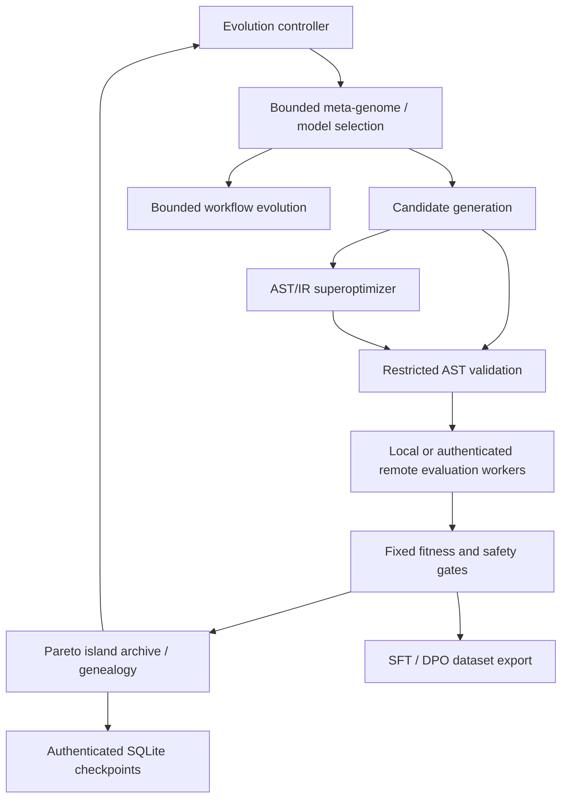

# OMEGA-X Evolution Ω


**Autonomous Evolutionary Intelligence & Scientific Discovery Engine**


OMEGA-X Evolution is an independent research and engineering project maintained in [mojealterego/Omega-X-Evolution-](https://github.com/mojealterego/Omega-X-Evolution-). Its objective is to create a controlled, reproducible evolutionary intelligence engine that discovers and improves algorithms, optimizes search strategies, and progressively evolves agent workflows under fixed verification and resource constraints.

The project builds upon the open-source ShinkaEvolve framework and incorporates research ideas from AlphaEvolve and the Darwin Gödel Machine. These are foundations and research references, not claims of equivalent implementations, reproduced scientific results, or superiority.

## Architecture



The diagram describes the implemented optional OMEGA-X research path. The general upstream execution path is separate and does not inherit its restricted interpreter guarantees.

## Current implementation — v18

| Component | Capability |
|---|---|
| Runtime hardening | Process lifecycle, SLURM shell safety and integrity regression checks |
| Pareto–Gödel–Elites | Multi-objective selection, island archives, genealogy and migration |
| MetaGenome | Bounded adaptation of selection parameters and model routing |
| Candidate validation | Restricted arithmetic expression interpreter and exact patch contract |
| Evaluation | Fixed benchmark, staged validation, holdout excluded from worker inputs |
| Persistence | Authenticated SQLite generation snapshots and deterministic offline resume |
| Parallelism | Local process pool and authenticated network worker protocol, durable leases, deterministic commits |
| Meta-agent | Bounded mutation of operator workflows with independent seed promotion |
| AST/IR | Binary64-preserving source rewrites and common-subexpression elimination |
| Formal verification | Nine Z3-checked binary64 rewrite families and independent IR verification |
| Knowledge distillation | Offline categorical teacher/student operator model plus SFT/DPO export |
| Multilevel coevolution | Role-specific workflows, migrating team demes, fixed validation promotion |
| Recursive improvement | Fresh validation gates, bounded policy iteration and outer checkpoint |
| Benchmarking | Equal proposal-budget paired comparisons |
| Discovery | Bounded symbolic regression and reproducible evidence |
| Polyglot evolution | Validated u16 IR and six native/interpreted language backends |
| Neuro-symbolic | Certified symbolic expression plus trained residual MLP |
| Neural architecture search | Bounded evolution of hidden layers, activation, learning rate and optimizer; real CPU training |
| Heterogeneous inference | CPU and optional Torch CUDA/MPS/Ascend NPU adapters; memory admission and reference checking |
| Graph memory | Tenant-scoped authenticated nodes and edges, bounded cited retrieval |
| Experiment planner | Budget-driven symbolic/neural/hybrid comparison with final test isolation |

**Status:** development snapshot, not a production distributed system. The network evaluator has been tested on loopback with actual worker processes and TLS; no external cluster, HA coordinator or throughput gain is established. Independent recomputation is mandatory. Arbitrary-code execution, unrestricted agent self-rewriting, formal verification of arbitrary programs and large-model training remain out of scope. Small MLPs now train end-to-end on CPU in explicit research modes.

## Roadmap

| Stage | Objective | Status |
|---|---|---|
| v1–v3 | Hardening, bounded coevolution, durable recovery | Implemented within documented scope |
| v4.1 | Distributed evaluation | Implemented within bounded protocol; local network/process/TLS verification |
| v5 | Meta-agent evolution | Bounded operator workflow evolution implemented and verified |
| v6 | AST/IR superoptimization | Bounded binary64 rewrite + DAG IR implemented and verified |
| v7 | Formal verification | Bounded rewrite rule proofs and IR checker implemented |
| v8 | Knowledge distillation | Categorical operator student fitted and evaluated offline |
| v9 | Multilevel coevolution | Three-level bounded team evolution implemented and evaluated |
| v10 | Recursive self-improvement with fixed promotion gates | Bounded policy iteration with authenticated outer checkpoints |
| v11 | Comparative benchmarks | Paired offline strategy comparisons; external reproduction open |
| v12 | Scientific Discovery Engine | Two-variable symbolic regression from observations |
| v13 | Polyglot program evolution | Pure u16 IR; Python, C, C++, JavaScript, Go, Java; arbitrary programs open |
| v14 | Neuro-Symbolic Evolution Engine | Verified symbolic regression + learned residual; bounded two-variable domain |
| v15 | Algorithm and neural architecture evolution | Real MLP training, architecture and optimizer search; large models open |
| v16 | Heterogeneous CPU/GPU/NPU orchestration | Bounded MLP inference router; CPU verified, accelerator hardware open |
| v17 | Durable GraphRAG evolutionary memory | Authenticated SQLite graph and lexical/provenance retrieval |
| v18 | Automatic experiment construction | Typed budgeted comparative plans, validation selection and graph recording |
| v19 | Multi-domain Scientific Discovery Engine | Open |
| v20 | Integrated autonomous research runtime | Open |

No stage is promoted solely on generated logs or self-reported improvements.

## Getting started

Requires Python 3.10 or newer. Install from this repository, not the upstream PyPI package, to obtain the OMEGA-X extensions.

```bash
git clone https://github.com/mojealterego/Omega-X-Evolution-.git
cd Omega-X-Evolution-
python -m venv .venv
source .venv/bin/activate
python -m pip install -e .
omega-x-evolution --seed 5 --generations 5 --evaluation-processes 2
# Or: python -m omega_x_evolution --seed 5 --generations 5 --evaluation-processes 2
```

This command uses the bounded offline experiment; it does not require paid inference. The canonical distribution is `omega-x-evolution` (development version `0.18.0.dev1`), with implementation in `omega_x_evolution`. The offline engine uses the standard library. The imported Shinka runtime and compatibility entry points remain bundled, so use a separate virtual environment from upstream `shinka-evolve`. See [migration guide](docs/omega/IDENTITY_MIGRATION.md).

## Advanced modes

```bash
python -m omega_x_evolution.distributed --help
python -m omega_x_evolution.meta --rounds 3 --population 4 --generations 3
python -m omega_x_evolution.superopt '(-(-(x*1))/1)+(x+y)*(x+y)'
```

See [v4.1–v6 deployment and acceptance scope](docs/omega/EVOLUTION_V41_V6.md) before enabling network endpoints. The canonical offline engine requires only the standard library; legacy upstream components retain their dependencies.

## v7–v9 research commands

```bash
omega-x-formal --rules
omega-x-knowledge --records-per-seed 12
omega-x-multilevel --rounds 3 --demes 3 --population 4 --generations 2
```

Certified optimization requires a system Z3 shared library. See the [scope and instructions](docs/omega/EVOLUTION_V7_V9.md).

## v10–v12 research commands

```bash
omega-x-recursive --rounds 4 --population 5 --generations 2
omega-x-benchmarks --budget 256
omega-x-discovery --task squares --seed 2026 --budget 128
```

See [bounded implementation and remaining gaps](docs/omega/EVOLUTION_V10_V12.md).

## v13–v15 research commands

```bash
omega-x-polyglot --seed 42 --budget 1024 --verify
omega-x-hybrid --seed 42 --epochs 400
omega-x-nas --seed 42 --task xor --rounds 3 --population 4 --epochs 180
```

Neural modes require NumPy, hybrid also requires system Z3; compiler verification uses installed local toolchains. See [v13–v15 scope and evidence](docs/omega/EVOLUTION_V13_V15.md).

## v16–v18 research commands

```bash
omega-x-compute --torch --npu --demo
omega-x-experiments --task smooth --epochs 400 --budget 128
omega-x-experiments --task smooth --plan-only
```

CPU inference is verified locally; optional accelerator adapters require installed compatible Torch runtimes and real hardware. Graph memory and experiment planning are documented in [v16–v18](docs/omega/EVOLUTION_V16_V18.md).

## Verification

```bash
python -m pip install pytest
python -m pytest -q tests/test_omega*.py
python scripts/verify_hardening.py
```

The imported v4 verification record reports 42 targeted OMEGA tests and 38 hardening tests passed. Full upstream collection was blocked by missing dependencies. No live distributed cluster, external scientific benchmark reproduction, large-model training or production attestation is claimed. These are historical results. See [current verification](docs/omega/verification-v18.txt) for the new regression results and outstanding upstream dependency limitations.

## Documentation & evidence

- [v16–v18 implementation and evidence](docs/omega/EVOLUTION_V16_V18.md)

- [v13–v15 implementation and evidence](docs/omega/EVOLUTION_V13_V15.md)
- [v10–v12 implementation and evidence](docs/omega/EVOLUTION_V10_V12.md)
- [v7–v9 implementation and evidence](docs/omega/EVOLUTION_V7_V9.md)
- [v4.1–v6 implementation, benchmarks and operating instructions](docs/omega/EVOLUTION_V41_V6.md)
- [Namespace and packaging migration](docs/omega/IDENTITY_MIGRATION.md)
- [OMEGA-X coevolution architecture](docs/OMEGA_COEVOLUTION.md)
- [Runtime hardening](docs/OMEGA_HARDENING.md)
- [Research traceability v4](docs/omega/RESEARCH_TRACEABILITY_v4.md)
- [Verification record v4](docs/omega/verification-v4.txt)
- [Original import record](OMEGA_IMPORT.md)
- [Imported source manifest v4](docs/omega/IMPORT_MANIFEST_v4.json) — historical snapshot, not a manifest of subsequent changes.
- [Preserved ShinkaEvolve documentation](README.upstream.md)

## Engineering & security policy

Development takes place on `main`. Upstream GitHub Actions definitions remain inactive in `docs/upstream-workflows/`. Promotion requires reproducible evidence and explicit verification. Evolution must not weaken evaluator integrity, fixed safety gates, authorization, or operator resource limits. Local multiprocessing is not a security sandbox.

## Origins and license

OMEGA-X Evolution is a separately maintained derivative project, not an official Sakana AI or Google DeepMind release.

- **ShinkaEvolve** — Sakana AI; [source repository](https://github.com/SakanaAI/ShinkaEvolve), [paper](https://arxiv.org/abs/2509.19349). Original authorship, citations and documentation are retained in [README.upstream.md](README.upstream.md).
- **AlphaEvolve** — Google DeepMind; [research overview](https://deepmind.google/discover/blog/alphaevolve-a-gemini-powered-coding-agent-for-designing-advanced-algorithms/).
- **Darwin Gödel Machine** — Sakana AI and collaborators; [research overview](https://sakana.ai/dgm/).

See [LICENSE](LICENSE) for the Apache-2.0 license. Existing copyright and attribution notices are preserved. Research references are not automatically redistributed as project-owned code.

---

**OMEGA-X Evolution Ω · Evolution with evidence.**
