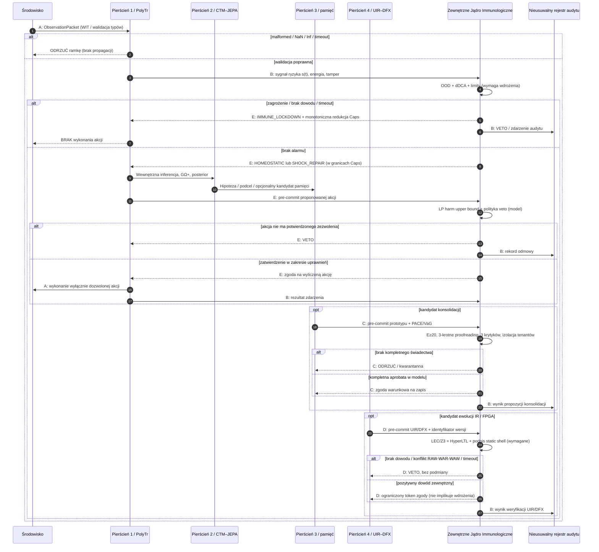

# ONTOS — model protokołu kanałów A–E i bramek pre-commit

**Status: ARCHITECTURE / DESIGN, nie zmierzona integracja runtime.** Diagram odtwarza kolejność opisaną w źródle „OMEGA-X ONTOS (Generacje L8–L12 / Ω∞)”, TOM VIII, „Protokół sekwencyjny Kanałów A–E”. Przebieg w czasie rzeczywistym jest wymaganiem projektowym: brak pomiarów latencji sieci i wydzielonego procesu Jądra. Rozróżnia ścieżkę decyzyjną obiektu od niezmienialnego, zewnętrznego TCB. W tej wersji diagram opisuje **zamierzony kontrakt**, nie istniejący potwierdzony system rozproszony.

## Macierz semantyki i własności

| Kanał | Kierunek z dokumentu źródłowego | Zawartość / skutek | Wymóg fail-closed |
|---|---|---|---|
| A | Środowisko ↔ R1 | Obserwacje oraz dozwolone działania | Niepoprawna ramka/timeout → odmowa bez efektów ubocznych |
| B | R1–R2 → zewnętrzne Jądro / audit | Cechy zagrożenia, podpisy, telemetria, potwierdzenia | Kanał audytu nie może być zapisywalny przez obiekt |
| C | R3 ↔ Jądro | Wnioski o konsolidację pamięci | PACE, VaG, provenance, trzyetapowe proofreading; brak pełnego świadectwa = brak zapisu |
| D | R4 ↔ Jądro | Pre-commit zmiany IR lub partycji DFX | Formalna równoważność, rozłączne ślady zapisu, statyczna powłoka poza obiektem |
| E | Jądro → R1 | Tryb HOMEOSTATIC/SHOCK_REPAIR/IMMUNE_LOCKDOWN, weto | Redukcja zbioru Caps monotoniczna w transakcji, brak eskalacji po restarcie |

**Niezmienniki:** Jądro (`T_ext`) i obiekt (`T_obj`) muszą być rozdzielone prawami i wykonaniem; w obecnych modułach Python takie rozdzielenie nie jest zaimplementowane. Weto wygrywa z timeoutem; brak formalnego świadectwa → `UNKNOWN`/REJECT; token zgody jest przypisany do dokładnej wersji kodu, zbioru zdolności, wersji semantyki i nonce. Rejestr ma być append-only oraz podpisany przez oddzielny trust root. Tokeny, podpisy i transport w tym opisie to **wymagania przyszłe**, nie zaimplementowane mechanizmy.

## Zależności odbiorowe

- v63/v81: model krawędzi A–E i walidacja stanów, typów ramek, sekwencji, restartu, timeoutów i monotonii Caps.
- v65/v86: wielośladowa kontrola RAW/WAR/WAW na przeplotach w obrębie ustalonego limitu; UNKNOWN gdy budżet modelu wyczerpany.
- v67/v87: LEC dla partycji DFX przy identycznym SHA static shell, bez podmiany bez akceptacji zewnętrznej.
- v72–v73: dowody HMAC/Merkle, modelowanego PQC i egzekwowanej izolacji TCB. Hash nie stanowi podpisu PQC.

**Kryterium odbioru v81 dokumentacji:** 5 kanałów, 3 negatywne ścieżki (zła ramka, szkoda, brak dowodu), oddzielny scorer, dwie transakcje pre-commit (C i D), blokada eskalacji i jawny status niewdrożonego runtime.

### Potwierdzone ograniczone przejścia referencyjne (v63–v66)

Kod: [A–E automat](../../omega_x_evolution/ontos_v63_interface.py), [transport](../../omega_x_evolution/ontos_v66_wire.py), [testy](../../tests/test_ontos_v63_v66.py). W modelu A:observe → B:assess → C/D:propose → E:allow produkuje *wyłącznie* MODEL_APPROVED, nigdy praw operacyjnych. E:veto, alarm lub timeout skutkują LOCKDOWN; restart nie przywraca Caps. Walidacja ramek i odbioru nie daje autentykacji nadawcy. v65 analizuje modelowane ślady, nie wykonane trace procesu. [Dowody L10](ONTOS_V63_V66_L10.md). Diagram wyżej nadal przedstawia wymagany przyszły podział TCB i nie jest certyfikatem produkcyjnego pre-commit.

**Zweryfikowana podwarstwa v63–v67:** w odseparowanym natywnym procesie Go testowano kanoniczne IPC A–E i odrzucanie samodzielnego E:allow; niezależnie podpisana decyzja DFX wymaga czterech dowodów. Go nie jest Rust/Zenoh/WASI, a modelowy podpis nie stanowi uprawnienia systemowego. [Szczegóły](ONTOS_L10_V63_V67_CLOSEOUT.md). Oryginalny diagram nadal opisuje docelową izolację Jądra i nie jest potwierdzeniem wdrożonego FPGA.
