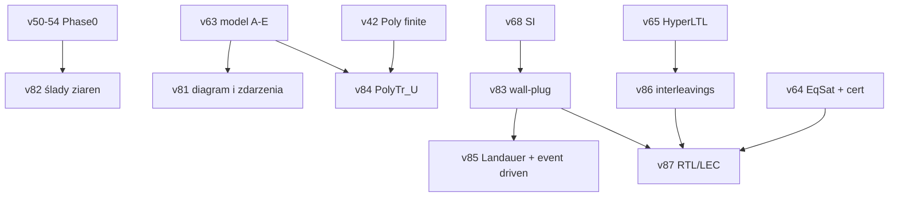

# OMEGA-X ONTOS — rozszerzenia architektoniczne v81–v87

**Kategoria:** user-requested engineering extensions (E), nie wyniki powtórzone eksperymentalnie z dokumentu Argona. Data rejestracji 2026-11-21. Wszystkie elementy podlegają GATE-01..09. Dokument jest podporządkowany istniejącej [Roadmapie Ω∞](ONTOS_OMEGA_INFINITY_ROADMAP.md), bez kasowania wymagań v1–v80.

## Matryca pokrycia i statusów

| ID / etap | Nowe wymaganie i powiązanie z istniejącą Roadmapą | Rzeczywisty status | Kryterium przyszłego zamknięcia |
|---|---|---|---|
| EXT-01 / v81 | Diagram sekwencyjny Kanałów A–E z protokołem pre-commit; wcześniej v63/65 miały jedynie zapis tekstowy; źródło TOM VIII | **Diagram przygotowany; wykonawczy protokół OPEN** | [Diagram A–E](ONTOS_CHANNELS_A_E_SEQUENCE.md) odwzorowuje fazy A/B/E/C/D; uruchomiony model stanów z negatywnymi testami timeout/NaN/veto; monotonii Caps i dowodu oddzielenia TCB nie zaliczać bez egzekucji |
| EXT-02 / v82 | Ślady 9216, 9274, 9651 — rozszerzenie v50–v54/Phase0 | **Synthetic diagnostic snapshots TESTED; odtworzenie źródłowych błędów OPEN** | [Podsumowanie 3 ziaren](PHASE0_FAILURE_SEEDS_SUMMARY.json), pełne 720 obserwacji i 720 wyników scorera w ZIP oraz kod odtwarzania `scripts/ontos_phase0_seed_diagnostics.py`, SHA oryginalnego trace, walidacja bez przecieku i właściwe skutki korekt pamięci; konieczny osobny replay faktycznego kodu źródłowego, gdy dostępny |
| EXT-03 / v83 | Rozdzielenie P_accelerator_peak, P_wall_plug i E_core/E_wall; rozwija v68/v69/v71 | **Specyfikacja jednostek przygotowana; pomiar i walidacja OPEN** | [Tabela parametrów](ONTOS_ENERGY_BOUNDARIES.md), 6 podłoży z UNKNOWN bez danych, symulator ADC/DAC/PSU/cooling/wear, czas, p95, przedział kalibracji i testy kosztów awaryjnych |
| EXT-04 / v84 | PolyTr_U wyższego rzędu: dynamiczne śledzenie adjunkcji w kategorii fibrowanej, rewizje interfejsów i koindukcja; rozszerza v42/v63 | **OPEN** | Skończona semantyka fibracji, jawne funktory bazowe, świadectwo adjunkcji i tożsamości, rewizje grafu interfejsu, model checking na 4–8 obiektach, zachowanie bezpiecznego U_safe, rollback na kontrprzykładzie, brak rozszerzania uprawnień |
| EXT-05 / v85 | Landauer-Bounded Free Energy / metabolizm zdarzeniowy i SOT-MRAM; rozwija v38/53/68–71 | **OPEN** | Asynchroniczna kolejka zdarzeń z deterministycznym schedulerem i idempotencją; bilety kosztu przed pracą, ograniczenie jitter/latency, saturacja, backpressure, fault injection i modele rozdzielające E_core/E_wall; bez realnego SOT-MRAM twierdzenie o zysku jest tylko scenariuszem |
| EXT-06 / v86 | Wzmocniony HyperLTL \(\forall^*\psi\) dla interleavings i konfliktów RAW/WAR/WAW; rozwija v65/v73 | **OPEN** | Zamrożony TCB i model wejścia, bounded trace self-composition z włączonymi przeciwnymi przeplotami, counterexample dla błędnych certyfikatów, kontrola tenantów, jawne UNKNOWN przy timeout/wyczerpaniu pamięci; brak twierdzeń o „całkowitej eliminacji” konfliktów poza rozważonym modelem |
| EXT-07 / v87 | Autonomiczna synteza wyłącznie kandydata RTL i LEC/Z3; zachowanie static shell w FPGA DFX; rozwija v64/v67/v72–73 | **OPEN** | SHA statycznej powłoki przed/po, niezależny fixed-shell verifier, porównanie semantyki skończonej RTL w CIRCT LEC/Z3, test kontrprzykładu, reset/timeout, deny-by-default przy UNKNOWN; bez programowania FPGA i bez samozatwierdzającej się zmiany korzenia zaufania |

## Zależności (DAG)

## Akceptacja i zakazy nieprawdziwych gwarancji

1. Każda implementacja musi mieć własny test RED/GREEN, SHA kodu/testu, komendę, wynik, próbki regresyjne, negatywny test i ślad replikacji.
2. `T_ext ≠ T_obj` to wymagana **egzekwowana granica uprawnień**, nie atrybut klasy Python; dopiero niezależny proces/sprzęt z właściwą izolacją może ją potwierdzić.
3. LEC/Z3 na skończonej domenie to dowód wyłącznie zadeklarowanej semantyki, nie nieskończonej ewolucji. Wersje sprzętowe wymagają izolowanej kwalifikacji, której nie wolno utożsamić z symulacją.
4. W metryce fizycznej `UNKNOWN` nigdy nie może zostać zastąpione 0. Nie ustalać „zysku SOT-MRAM” przez mieszanie nJ rdzenia, nJ wall-plug, W chwilowej mocy i FLOPs.
5. Długie ślady HyperLTL z ograniczeniem zasobów mogą generować `UNKNOWN`. Gdy formalne świadectwo jest niekompletne, brak automatycznej promocji i wykonania DFX.
6. Rozszerzenia v81–v87 nie zmieniają istniejącego ograniczonego GATE-09 PASS ani nie nadają uprawnień nowym modułom. Status końcowy nowego zakresu: OPEN.

## Referencje metodologiczne

- Zewnętrzny dokument użytkownika „OMEGA-X ONTOS (Generacje L8–L12 / Ω∞)”, TOM VI–VIII: energia, Jądro Immunologiczne, kanały A–E.
- [CIRCT LEC — dokumentacja kompilatora](https://circt.llvm.org/docs/Tools/circt-lec/): ograniczona równoważność w dialektach HW/Comb/Seq (nie gwarancja wszystkiego RTL).
- [Monitoring hyperproperties / HyperLTL](https://arxiv.org/abs/1807.00758): weryfikacja wielośladowa i ograniczenia skończonych logów.
